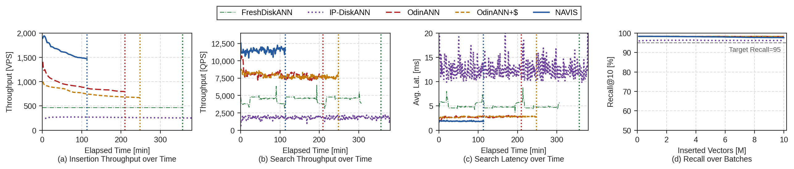
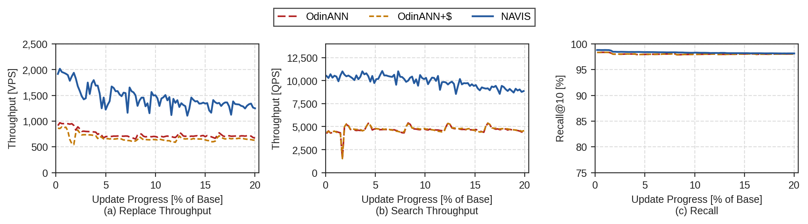

# NAVIS

**NAVIS: Concurrent Search and Update with Low Position-Seeking Overhead in On-SSD Graph-Based Vector Search** (PVLDB, Vol. 20, No. 3). Paper: [`paper/VLDB27_NAVIS.pdf`](paper/VLDB27_NAVIS.pdf).

On-SSD graph-based vector search keeps a proximity graph on SSD and compressed (PQ) vectors in memory. With concurrent updates, the bottleneck is **position seeking**: the graph traversal that finds the neighbors of every inserted vector. It explores far more vertices than a search, and the usual packed layout (vector and edge list in one 4 KiB page) drags a full vector along with every edge list it reads. NAVIS redesigns position seeking around **locality-driven decoupling** of vectors and edge lists, which it combines with convergence-aware reranking, a dynamic entrance graph, and a prioritized edge-list cache.

## How NAVIS works

**Locality-driven decoupling (on-disk layout).** Vectors and edge lists live in separate files. The edge-list file packs several edge lists into each 4 KiB page, placed by Starling-style greedy page-locality partitioning so that vertices traversed together share a page. An in-memory indirection table maps each vertex to its edge-list slot and its vector slot. Traversal reads only edge pages. Insertions write edge lists **out of place** into fresh slots, preferring pages whose slots have all been invalidated, and write only the new vertex's vector.

**CASR, convergence-aware speculative reranking.** After traversal, the explored set is ranked by PQ distance and full vectors are compared one at a time in that order. Reranking stops once the exact top-K has gone `w` consecutive loads without changing. After a top-K change, the next `w` vectors are needed regardless, so they are read speculatively as one batch; a rerank loads exactly (last change + `w`) vectors, with no reads wasted past convergence. Search and position seeking use the same mechanism with separately calibrated windows, `w_search` and `w_insert`. During a warm-up (the first 1,000 reranks of each path), every candidate is loaded and the smallest window that would not have stopped each rerank early is recorded; `w` is a percentile of those values: the maximum (P100) for search and P90 for insertion by default. For position seeking, neighbor pruning uses the exact vectors CASR loaded; candidates that were not reranked are represented by deflated (PQ-reconstructed) vectors.

> **Enhanced in this release.** This *windowed* CASR improves on the paper's version, which loaded vectors in calibrated stages and stopped after two unchanged stages. Checking convergence per vector lets each rerank stop at its own convergence point.

**NAVIS-Update, the dynamic entrance graph.** Search starts from a small in-memory entrance graph (about 1% of vertices). NAVIS keeps it fresh as data changes: while `|G_ent| < r_ent * |G|`, a new vertex is promoted into it. Promotion reuses the explored sets of the insertion that just ran and needs no extra traversal, so its cost is negligible.

**NAVIS-Cache, prioritized edge-page caching.** This is a host-memory cache of edge pages with two regions. A **mostly-frozen region** (90%) resists eviction; when it is full, the earliest-promoted page is evicted. An LRU **admission window** (10%) holds new pages, and a page must be hit twice in the window before it is promoted. Lookups from user search promote only at a much higher hit count, so transient query traffic cannot churn the frozen region. The cache is write-through. In-flight writes live in a separate RMW page cache, and readers look up the RMW cache, then NAVIS-Cache, then the SSD.

**Deletion.** Deletes are lazy. A deleted vertex is immediately excluded from results, entry points, and new neighbor lists, but stays traversable so the graph remains connected. The search frontier is enlarged in proportion to the deleted fraction.

**I/O.** All storage I/O uses io_uring with `O_DIRECT`. Each worker thread owns a private ring (queue depth 256) per file, the files are registered as fixed files, and completions are harvested in batches. Structural updates are handed to a background writer that merges adjacent sectors.

## Performance

FineWeb (768-d) with a 50M-vector base index, all systems on the same server (AMD Ryzen 9 7950X3D, 16 cores; 64 GB DRAM, half the paper's 128 GB; Crucial T705 PCIe 5.0 SSD). Every system uses R = 96, beam width 4, |E_search| = 40, |E_pos| = 100, K = 10, and 22 search and 10 insertion threads, with the batch and measurement cadence of the [walkthrough](#walkthrough-fineweb). The baselines, converted from the same NAVIS index, and the scripts that run them are in [`baselines/`](baselines/README.md).

- **Throughput**: vectors inserted, divided by the total batch insertion time (for FreshDiskANN, including its merges).
- **Search QPS and P50 / P99 latency**: averages over the search passes that run concurrently with the batches.
- **Recall@10**: average over the search passes after each batch, each against exact ground truth over the vectors live at that point.

### Comparison with Baselines (Concurrent Insert-Search)

10M insertions in 100 batches of 100K (50M → 60M vectors). Reproduce NAVIS with `scripts/fineweb_insert.sh`.

| System | Host cache | Insert throughput (vectors/s) | Search QPS | P50 / P99 latency (ms) | Recall@10 |
|---|---|--:|--:|--:|--:|
| FreshDiskANN¹ | none | 467 | 4,486 | 4.76 / 9.48 | 98.36% |
| IP-DiskANN² | 16 GiB codes + 4 GiB pages | 240 | 1,839 | 11.11 / 32.10 | 96.23% |
| OdinANN | none | 802 | 7,990 | 2.52 / 4.89 | 98.27% |
| OdinANN+$³ | 16 GiB NAVIS-Cache | 677 | 7,839 | 2.55 / 5.07 | 98.26% |
| **NAVIS** | 16 GiB NAVIS-Cache | **1,485** | **11,500** | **1.73 / 4.04** | **98.02%** |

¹ Buffered insertion: new vectors go to an in-memory index, built with L = 128 (FreshDiskANN's default; the paper's runs used 0), that is merged into the disk index every 3M points. Searches start from the 10 nearest vertices of NAVIS's entrance graph, and the idle in-memory index is freed before it is reallocated. The merges need more than 60 GB of memory, so this run kept a 60 GB limit and let them swap (up to 30 GB; `MEM_ALLOW_SWAP=1` in [`baselines/`](baselines/README.md)).<br>
² The in-place update path of DiskANN3 (Bf-tree storage, 1-bit spherical codes in memory), with insertion matched to OdinANN and NAVIS: exact reranking of the top-L candidates and neighbor pruning on full vectors.<br>
³ OdinANN with NAVIS-Cache. Its packed layout stores vectors and edge lists in the same pages, so the cache holds far fewer edge lists for the same memory; its hit rate was 9–13% in these runs.



(a) Vectors inserted so far divided by the elapsed time, with FreshDiskANN at its time-averaged rate, merges included. (b, c) The concurrent search passes, averaged per minute. IP-DiskANN continues to 703 minutes. Plotted by [`baselines/plot_curves.py`](baselines/README.md).

### Comparison with In-Place Update Baselines (Concurrent Delete-Search)

Each of 100 batches inserts 100K new vectors and deletes the 100K oldest, so 20% of the base is replaced while the live set stays at 50M; one deletion thread runs alongside. Reproduce NAVIS with `scripts/fineweb_delete.sh`.

| System | Host cache | Replace throughput (vectors/s) | Search QPS | P50 / P99 latency (ms) | Recall@10 |
|---|---|--:|--:|--:|--:|
| OdinANN | none | 734 | 4,857 | 2.32 / 4.70 | 98.02% |
| OdinANN+$³ | 16 GiB NAVIS-Cache | 663 | 4,881 | 2.29 / 4.77 | 98.02% |
| **NAVIS**⁴ | 16 GiB NAVIS-Cache | **1,429** | **9,833** | **2.05 / 4.60** | **98.31%** |

⁴ Deletes are lazy, so NAVIS widens both frontiers to ⌈|E| / (1 − d)⌉ + 10, where d is the fraction of ids deleted so far. In this run, |E_search| grows from 40 to 51 after the first batch and to 58 after the last (d = 16.7%), and |E_pos| grows from 100 to 111 and then 130.



(a) The replace throughput of each batch. (b) The mean QPS of the concurrent search passes in each batch.

## Requirements

- Linux 5.6+ (io_uring). The paper's experiments ran on Ubuntu 24.04.
- An NVMe SSD with a filesystem that supports `O_DIRECT` (ext4, XFS).
- 64 GB of RAM is enough for the FineWeb walkthrough with the settings below. Ground truth stays within `--mem-budget`, the index build sizes its graph shards from it, and a full run peaks at about 41 GiB RSS with a 16 GB cache.
- GCC 9+ or Clang 10+ (C++17), CMake 3.24+, OpenMP, jemalloc, and BLAS (OpenBLAS or Intel MKL; used only for ground-truth computation).
- Network access on the first CMake configure. Pinned versions of liburing (2.10), tsl-robin-map, and libcuckoo are downloaded and hash-checked.

```bash
sudo apt install build-essential cmake libjemalloc-dev libopenblas-dev
```

## Build

```bash
cmake -B build
cmake --build build -j
ctest --test-dir build        # unit tests (optional)
```

This produces three tools:

| Tool | Purpose |
|------|---------|
| `build/navis_convert` | Data preparation: base subset and per-batch ground truth (insert and delete workloads) |
| `build/navis_build`   | Builds the index (PQ, Vamana graph, Starling placement, entrance graph) |
| `build/navis_bench`   | Runs NAVIS: search, concurrent search + insertion, deletion |

Binaries are built with `-march=native`.

## Walkthrough: FineWeb

This reproduces the paper's FineWeb setup: a 50M-vector base index, 10M insertions in 100 batches of 100K, 22 search and 10 insertion threads, and a 16 GB NAVIS-Cache.

The scripts in `scripts/` wrap every step below. Paths and sizes come from environment variables (defaults in `scripts/fineweb_env.sh`), and each run is logged to `logs/`:

| Script | Runs |
|--------|------|
| `fineweb_prepare.sh` | base subset, ground truth (insert and delete workloads), index build |
| `fineweb_search.sh [L ...]` | search only, 32 threads, after 10 cache warm-up passes |
| `fineweb_insert.sh` | concurrent search + insertion, 22 / 10 threads |
| `fineweb_insert_only.sh` | insertion only, 32 threads |
| `fineweb_delete.sh` | deletion workload, 22 search / 10 insertion / 1 deletion threads |

```bash
export DATA_DIR=/path/to/fineweb      # holds 80M_float.bin and 80M_query.bin
bash scripts/fineweb_prepare.sh
bash scripts/fineweb_insert.sh        # or NUM_BATCHES=10 for a shorter run
```

### 0. Data

The FineWeb dataset consists of [FineWeb-Edu](https://huggingface.co/datasets/HuggingFaceFW/fineweb-edu) documents embedded with [EmbeddingGemma](https://arxiv.org/abs/2509.20354) (768-d, float32). This walkthrough assumes the embeddings already exist as `.bin` files:

| File | Contents |
|------|----------|
| `80M_float.bin` | data vectors; the first 50M form the base index and the following rows are inserted |
| `80M_query.bin` | 10,000 query vectors |

The `.bin` format is `[uint32 num_vectors][uint32 dim][num_vectors × dim values, row-major]`.

```bash
DIR=/path/to/fineweb      # on the NVMe SSD
```

### 1. Prepare

```bash
# Base set: the first 50M vectors.
build/navis_convert subset $DIR/80M_float.bin $DIR/base_50M.bin --count 50000000

# Exact top-10 ground truth for every batch boundary of the insert stream
# (rows 50M..60M in batches of 100K): gt_0.bin ... gt_10000000.bin, for the
# insert workload (-o) and the deletion workload (--delete-o, see below).
build/navis_convert batch-gt $DIR/80M_float.bin $DIR/80M_query.bin \
    --index-npts 50000000 --total-npts 60000000 --batch 100000 \
    -K 10 --threads 32 --mem-budget 48 -o $DIR/gt --delete-o $DIR/gt_delete
```

Ground truth is one brute-force pass over the first `--total-npts` vectors, streamed in partitions sized to stay within `--mem-budget` (GB). It takes about 25 minutes on a 16-core machine. Both workloads come from the same pass: it records each query's top-10 within every block of 100K ids, and every live set (`[0, 50M + offset)` for insertion, `[offset, 50M + offset)` for deletion) is a union of whole blocks.

### 2. Build the index

```bash
build/navis_build -d $DIR/base_50M.bin -o $DIR/navis_fineweb \
    -t float -R 96 -L 100 --pq-bytes 128 --mem-budget 48
```

`--mem-budget` is the host-memory budget in GB for graph construction. If the graph does not fit, it is built in overlapping shards that are then merged. Leave headroom below physical memory, because the budget sizes the shards while later stages hold the full adjacency list (about 21 GB for 50M points); 48 suits a 64 GB machine. The build takes a few hours. Its outputs:

| File | Contents | FineWeb 50M |
|------|----------|-------------|
| `_disk.edge` | edge-list file (4 KiB pages) | 20 GB |
| `_disk.vec` | vector file | 154 GB |
| `_indirection.bin` | vertex → edge/vector slot map | 0.6 GB |
| `_pq_pivots.bin`, `_pq_compressed.bin` | PQ codebook and codes | 6.4 GB |
| `_mem.index{,.data,.tags}` | entrance graph (1% sample) | 1.6 GB |
| `_mem_graph`, `_partition.bin.aligned`, `_ent_sample_*` | build intermediates, not needed at run time (the [IP-DiskANN baseline](baselines/README.md) imports `_mem_graph`) | |

### 3. Run NAVIS

```bash
build/navis_bench -i $DIR/navis_fineweb -q $DIR/80M_query.bin -g $DIR/gt \
    --insert-data $DIR/80M_float.bin \
    --cache-gb 16 --search-threads 22 --insert-threads 10 \
    --search-L 40 --insert-L 100 --batch-size 100000 --num-batches 100
```

Insertions modify a shadow copy of the index (`navis_fineweb_shadow_*`, about 175 GB, and it grows during the run), so the built index is never changed and every run starts from the same state. Vector ids are row numbers in `80M_float.bin`, so batch `b` inserts rows `[50M + b·100K, 50M + (b+1)·100K)`.

The run reports:

| Line | Meaning |
|------|---------|
| `--- Search ---` | search-only pass over all queries on the initial index (QPS, mean/p50/p99 latency, Recall@10, vector loads per query) |
| `[  NNs] inserted ...` | while a batch runs (wait 5 s, search, pause 1 s, repeat): insertion progress and rate, plus one full concurrent search pass (QPS and latency; no recall, since the index is changing) |
| `Batch b done in ...` | batch insertion throughput and latency; vector loads per CASR rerank (search, insert); calibrated CASR windows `w_search`, `w_insert`; NAVIS-Cache hit rate; RSS |
| `after batch b:` | search pass on the post-batch index, scored against `gt_<(b+1)·100K>` |

Recall is computed against the `gt_<offset>.bin` file that matches the index contents (`gt_0` before insertion, `gt_<(b+1)·100K>` after batch `b`).

### Optional: deletion workload

The paper's deletion experiment (§9.9) replaces the data in a sliding window. Each batch also deletes the 100K oldest vectors, so the live set stays at 50M. Score it against the `gt_delete` ground truth from step 1 and pass `--workload-change`:

```bash
build/navis_bench -i $DIR/navis_fineweb -q $DIR/80M_query.bin -g $DIR/gt_delete \
    --insert-data $DIR/80M_float.bin --workload-change --delete-threads 1 \
    --cache-gb 16 --search-threads 22 --insert-threads 10 \
    --search-L 40 --insert-L 100 --batch-size 100000 --num-batches 100
```

### Optional: search only

```bash
build/navis_bench -i $DIR/navis_fineweb -q $DIR/80M_query.bin -g $DIR/gt \
    --num-batches 0 --search-threads 32 --warmup-passes 10 20 40 60 80
```

With `--num-batches 0`, the index is opened read-only (no shadow copy). `--warmup-passes 10` warms the cache with ten unreported passes over the queries, as in the paper. Trailing numbers sweep the search frontier `L`.

## Parameters

`navis_bench`:

| Flag | Default | Meaning |
|------|---------|---------|
| `--search-L` | 40 | search frontier \|E_search\| |
| `--insert-L` | 100 | position-seeking frontier \|E_pos\| (the paper uses 128 for ImageNet and 200 for DEEP) |
| `--mem-L` | 10 | entrance-graph search list size |
| `--beam-width` | 4 | edge pages read per traversal hop |
| `--search-threads` / `--insert-threads` | 22 / 10 | worker threads |
| `--batch-size` / `--num-batches` | 100000 / 10 | insertion batches (0 batches = search only) |
| `--workload-change`, `--delete-threads` | off, 1 | sliding-window deletion during insertion |
| `--cache-gb` | 16 | NAVIS-Cache size in GiB (0 disables it) |
| `--cache-window` | 0.10 | admission-window share of NAVIS-Cache |
| `--cache-promote` | 2 | window hits required for promotion |
| `--warmup-queries` | 1000 | CASR warm-up reranks per path |
| `--casr-percentile-search` / `--casr-percentile-insert` | 100 / 90 | percentile of the warm-up windows used as `w_search` / `w_insert` (higher = larger window, more vector loads, safer convergence); `--casr-percentile` sets both |
| `--ent-ratio` / `--ent-R` | 0.01 / 32 | entrance-graph target size (r_ent) and degree |
| `-K`, `-t`, `-m` | 10, float, l2 | top-K, data type (float, int8, uint8), metric |

`navis_build`: `-R` (max degree, 96), `-L` (build list size, 128), `--pq-bytes` (PQ bytes per vector: 64 for 512-d, 128 for 768-d in the paper), `--mem-budget` (GB; default 75% of physical memory), `--alpha` (1.2), `--sample` / `--ent-R` / `--ent-L` (entrance graph: 0.01 / 32 / 64), `--threads`. All evaluation uses L2; `-m cosine|ip` builds the graph with that metric, but PQ traversal distances remain L2-based.

## Citation

```bibtex
@article{song2026navis,
  title   = {{NAVIS}: Concurrent Search and Update with Low Position-Seeking
             Overhead in On-SSD Graph-Based Vector Search},
  author  = {Song, Jaeyong and Jang, Hongsun and Shin, Changmin and Park, Seongyeon
             and Ryoo, Yong Jae and Park, Seo Jin and Lee, Jinho},
  journal = {Proceedings of the VLDB Endowment},
  volume  = {20},
  number  = {3},
  year    = {2026}
}
```

## License

The code is released under the MIT License (see [`LICENSE`](LICENSE)). NAVIS builds on [DiskANN](https://github.com/microsoft/DiskANN), which is MIT-licensed: the graph construction (Vamana and its sharded build), product quantization, and the in-memory index format follow DiskANN, so NAVIS uses the same license, and [`NOTICE.txt`](NOTICE.txt) carries the notices of DiskANN and of NSG, which DiskANN builds on. The baselines in `baselines/` keep their own licenses (see [`baselines/README.md`](baselines/README.md#licenses)). The paper in `paper/` is distributed under CC BY-NC-ND 4.0.
